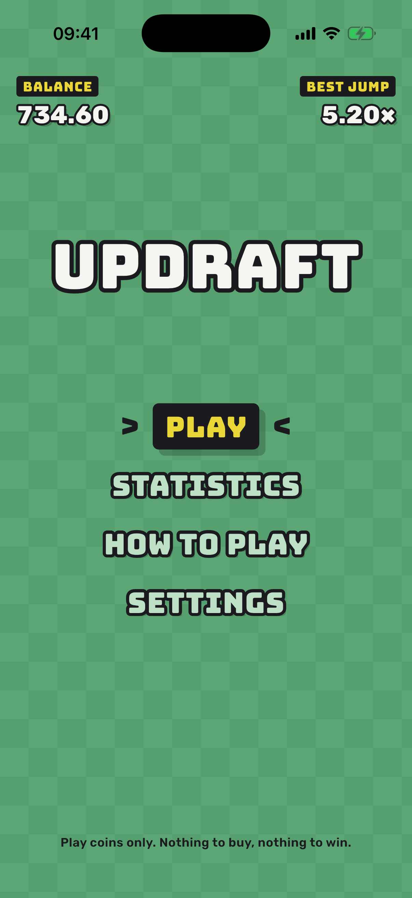
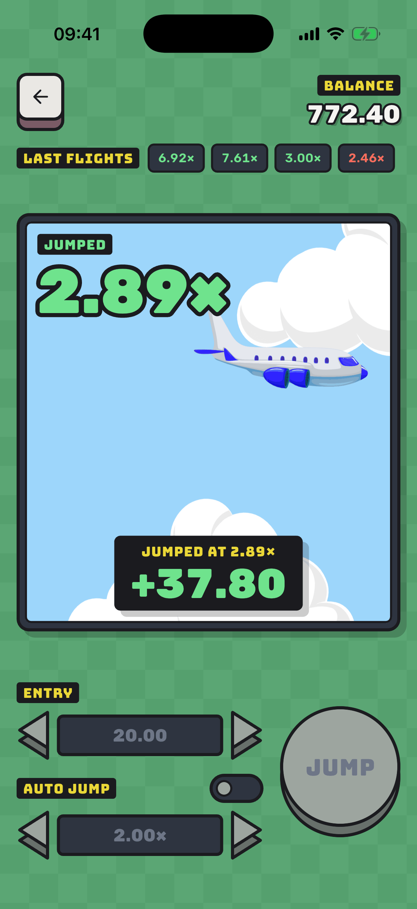
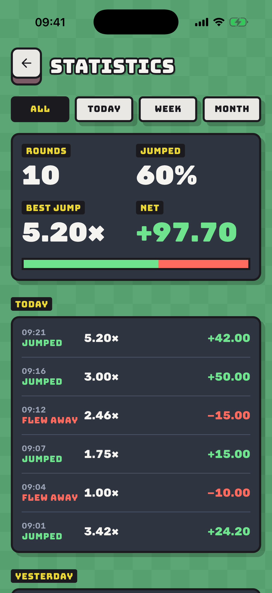

<div align="center">

# ✈️ Updraft

**A one-button flight game for Android and iOS about knowing when to jump.**

The plane climbs, the multiplier climbs with it, and the only decision is when
to let go — on a crash curve that pays back the same at any target.

[](https://flutter.dev)
[](https://dart.dev)
[](https://bloclibrary.dev)
[](#-privacy)
[](#-getting-started)

</div>

---

## 📖 Introduction

Updraft is a small, complete Flutter game dressed as a handheld machine from
the late eighties: a checkered shell, a slate screen with a plane in it, and
chunky buttons that sink when pressed. Choose an entry, take off, and jump
before the plane flies away. Coins are play money; there is nothing to buy and
nothing to win.

The codebase is worth reading for how little the screen decides. Where a flight
ends, how the multiplier grows, what a jump pays and what the balance allows are
pure Dart in `lib/utils/`, in integer cents and hundredths, with an injected
`Random`. One bloc owns the whole round and is driven by an injected clock, so a
complete flight — countdown, take-off, then a jump or a crash — runs in a unit
test without a widget, and the whole app runs in widget tests against in-memory
storages.

---

## 📸 Screens

<div align="center">

| 🕹️ Main Menu | 🪂 Jumped | 📊 Statistics |
|:---:|:---:|:---:|
|  |  |  |
| The balance and the best jump above an arcade menu. | A jump ends the flight and the plane leaves with the win. | Rounds, jump rate, best jump and net coins, by period and by day. |

</div>

---

## 🎮 How to Play

Pick an entry and press **Play**. After a three-second countdown the plane takes
off and the multiplier starts at **1.00×**, doubling every four seconds. Press
**Jump** while it is in the air to take the entry times the multiplier. Wait too
long and the plane flies away with the entry. The last fifteen flights sit in a
strip above the screen, each at its crash point: green where you jumped, red
where the plane flew away with the entry.

### Controls

| Control | What it does |
|---|---|
| ◀ ▶ **Entry** | Sets the entry in whole coins, from 1 to 25 and never above the balance |
| 🔘 **Auto jump** | Lets the machine jump for you at a target you choose |
| ◀ ▶ **Target** | Moves the target by 0.10× below 5×, 0.50× up to 20× and 1.00× beyond |
| ⚪ **Round button** | Play · Cancel · Jump with the live payout · Resume after a pause |

Holding an arrow repeats it, faster the longer it is held.

### Design Decisions

These are deliberate, and some differ from the obvious default:

- 🪙 **Coins are integer cents.** Entries, payouts, the balance and every
  recorded round are whole numbers of cents; a payout rounds down to the cent.
- ⏱️ **The multiplier is a function of time, not a running sum.** It is computed
  from the elapsed flight time on every tick, so it cannot drift and does not
  depend on the frame rate.
- 🎯 **Auto jump pays exactly the target.** If a frame lands past the target,
  the jump is still made at the target, on that same tick — never at the
  overshoot, and never if the plane flew away first.
- 🪂 **A jump ends the flight.** The counter freezes at your multiplier and the
  plane leaves with the win. The crash point the flight would have reached is
  still recorded, so the history strip shows where every flight really ended.
- 🛬 **Leaving mid-flight costs the entry.** Going back during the countdown is
  free; going back in the air asks first and records the round as lost.
- 🆘 **A refill is a last resort, and it is on the record.** When the balance can
  no longer cover the smallest entry, the game says so and Settings offers 100
  coins — the only time that button is active. Statistics shows each refill as
  its own highlighted entry between the rounds.
- ⏸️ **The round waits for you.** The flight holds still while the leave
  question is open, and pauses when the app goes to the background until you
  press Resume — the multiplier is a function of flight time, not wall time.
- 🔔 **Take-off, jump and crash carry revision counters.** Two identical rounds
  are still two take-offs and two exits, so the plane never misses a cue.
- 🧾 **How to play cannot disagree with the game.** Its payouts and its table of
  chances are computed by the same functions the round uses.

---

## ⚖️ The Fair Crash Curve

**Where a flight ends.** Each flight draws `U` uniformly from `[0, 1)` and ends
at `floor(97 / (1 − U))` hundredths, at least 1.00× and at most 100×. The
multiplier `m` is reached exactly when `97 / (1 − U) ≥ 100·m`, which happens with
probability **`0.97 / m`**: the plane reaches 2× in 48.5% of flights and 10× in
9.7%.

**Why every target pays the same.** Jumping at a target `m` pays `m` times the
entry with probability `0.97 / m`, so it returns **97% of the entry on average,
whatever `m` is.** A low target pays a little often, a high one a lot rarely, and
the two cancel. Choosing a target is a choice of variance, never of advantage.
About one flight in twenty-five ends at 1.00×, before anyone can jump.

**What the old curve did.** The original game drew the crash point uniformly
from 1.1× to 15×. The plane then reached 2× more than nine times in ten, and
always jumping at 2× returned 187% of the entry; at 5× and 10× the return was
360%. Every early target was a guaranteed profit, and balances only ever grew.

**Why the multiplier is a function of time.** The old multiplier added 0.1 every
250 ms, as a `double`; nine steps from 1.1 gave `2.000000000000001`. Updraft
computes `100 · 2^(t / 4 s)` from the elapsed time on each tick and floors it to
hundredths, and the crash and the jump compare integers. A jump at a target equal
to the crash point pays — the same `≥` that makes the probability `0.97 / m`.

> Across a million seeded flights in the test suite, always jumping at 1.5×, 2×,
> 5× or 10× returned 97% of the entry at every one of the four targets, to
> within one percentage point.

---

## 🛠️ Tech Stack

| Area | Choice |
|---|---|
| 🧩 Framework | Flutter 3.44.8 · Dart 3.12 |
| 🔄 State | [`flutter_bloc`](https://pub.dev/packages/flutter_bloc) — `RoundBloc`, `BalanceBloc`, `StatisticsBloc` |
| ⚖️ Value equality | [`equatable`](https://pub.dev/packages/equatable) |
| 💾 Persistence | [`shared_preferences`](https://pub.dev/packages/shared_preferences) behind storage interfaces |
| 🛩️ Animation | [`rive`](https://pub.dev/packages/rive) — one state machine, driven by revisions |
| 🔤 Type | Bungee and Rubik, bundled under the SIL Open Font License |
| 🧪 Testing | `flutter_test` · [`bloc_test`](https://pub.dev/packages/bloc_test) |
| 📏 Linting | [`flutter_lints`](https://pub.dev/packages/flutter_lints) |
| 📌 SDK pinning | [FVM](https://fvm.app) |

---

## 🏗️ Architecture

Dependencies point one way: widgets talk to blocs, blocs talk to pure rules and
to storage interfaces. `RoundBloc` owns the round — the entry, the countdown,
the live multiplier, the jump or the crash and the beat after it — and takes its
clock as a stream of elapsed times, so tests push time in by hand. It takes the
entry from `BalanceBloc` at take-off, credits the payout on a jump and records
the round in `StatisticsBloc` the moment it ends. Pausing stops its clock and
resuming continues it from the same elapsed time. The Rive scene is decoration:
it receives take-off and exit revisions and never decides anything.

```
lib/
├── base/      # BasePageState — the machine shell under every screen
├── blocs/     # RoundBloc for the flight, BalanceBloc, StatisticsBloc
├── data/      # the round record, storage interfaces and local storages
├── pages/     # one directory per screen, with private widgets beside it
├── res/       # design tokens: colors, text styles, spacing, shadows, strings
├── utils/     # crash curve, flight curve, coins, balance and round rules
└── widgets/   # machine controls, the flight scene, shared app bar and dialog
```

**Conventions worth noting**

- 🎲 Anything random takes a `Random` and anything timed takes a tick stream,
  so every round in the suite is replayable.
- 💉 Blocs receive storages, clocks and each other through constructors.
  Nothing reads a global and there is no service locator.
- 🧱 Storages only read, write and clear, and read damaged data as nothing:
  one malformed round is skipped instead of losing the history.
- 🔁 Every bloc handler emits before its first `await`.
- 🎨 Colors and text styles come from `AppColors` and `AppStyles`. A `Color` or
  `TextStyle` is never constructed at a call site.
- 🔤 Every user-facing string lives in `AppTexts`; every asset path in `Assets`.
- 🔢 The multiplier, coins and the countdown render with tabular figures.
- 🧼 No comments in Dart source — naming and structure carry the meaning.
- ✅ `flutter analyze` reports zero issues and the source is `dart format` clean.

---

## 🔒 Privacy

There is no backend, no account system, no ads and no telemetry, and the app has
no networking code at all. The balance, the recorded rounds and the refills are
entries in local preferences on the device. Nothing leaves the phone. **Clear
statistics** in Settings erases the rounds and the refills; the balance stays.

---

## 🚀 Getting Started

The Flutter version is pinned with [FVM](https://fvm.app), and platform folders
are not tracked in this repository — generate them once after cloning:

```bash
fvm install
fvm flutter create . --platforms=ios,android --org com.updraft --project-name updraft_flutter
rm test/widget_test.dart
fvm flutter run
```

> `flutter create` drops a template `test/widget_test.dart` alongside the real
> tests. It references a `MyApp` class this project does not define, so it fails
> to compile — delete it before running the suite.

A newer Flutter works without FVM — drop the `fvm` prefix — but it stamps its
own revision into `.metadata`, so expect that file to show as modified.
`pubspec.lock` is not tracked: `flutter create` re-resolves it on every setup.

### Development

```bash
fvm flutter pub get
fvm flutter test
fvm flutter analyze
fvm dart format --set-exit-if-changed .
```

---

<div align="center">

Built with Flutter 💙

</div>
